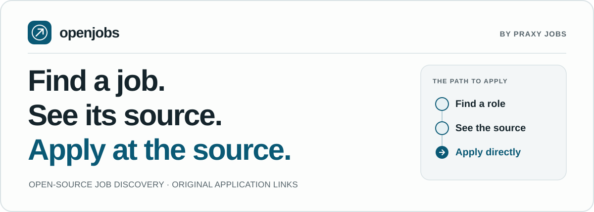
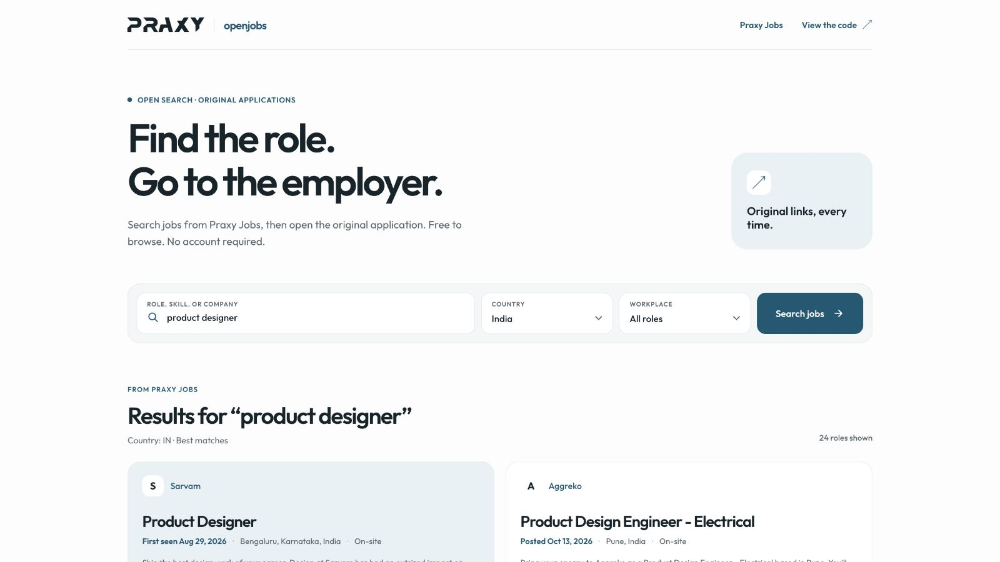

# OpenJobs



OpenJobs is an open-source job discovery project from [Praxy Jobs](https://praxyjobs.com/). We are building a free, anonymous search experience with original application links at `openjobs.praxyjobs.com`, linked from `praxyjobs.com/openjobs`.

[Search real jobs today ↗](https://praxy.me/jobs) · [Try the repository](#try-openjobs-in-one-minute) · [Use the Praxy Jobs API](#search-live-jobs-from-the-cli-or-mcp) · [Contribute](CONTRIBUTING.md)



*Local product preview using Praxy Jobs results. Public site deployment pending.*

> **Developer preview — October 22, 2026:** The CLI, local REST API, MCP server, and [`web/` source](web/README.md) work. The OpenJobs website is **not deployed yet**; [Praxy's existing search](https://praxy.me/jobs) is the live option. The keyless sample contains eight fictional jobs, and direct live CLI/MCP search needs an activated Praxy Jobs API key. See the [release checklist](docs/RELEASE_CHECKLIST.md) for the remaining website checks.

## What this project gives you

| If you want to… | Start here | Data boundary |
| --- | --- | --- |
| Find a real job now | [Praxy's live consumer search](https://praxy.me/jobs) | Public, anonymous browse on a separate deployed Praxy site. |
| Search live jobs from your agent or terminal | [`search-praxy`](#search-live-jobs-from-the-cli-or-mcp) or MCP `search_praxy_jobs` | Your activated `PRAXY_JOBS_KEY`; one direct API page; no local storage. |
| Build a local job search service | [Import the fictional sample](#try-openjobs-in-one-minute), then your permitted feed | SQLite index, REST, MCP, and inspectable import receipts. |

Each path keeps the original source URL. A source link and an observation time help you inspect a result; they do not guarantee that a job is still open or that its apply page still works.

## Try OpenJobs in one minute

Install Python 3.11+ and [uv](https://docs.astral.sh/uv/), clone this repository, then run:

```bash
uv sync
uv run openjobs import-json examples/demo.json --source demo
uv run uvicorn openjobs.api:app --host 127.0.0.1
```

In a second terminal:

```bash
curl -fsS 'http://127.0.0.1:8000/v1/jobs?query=engineer&work_mode=remote'
curl -fsS 'http://127.0.0.1:8000/v1/sources/demo'
```

The first request returns **two fictional remote engineer roles** from the eight-job sample. The second shows the import receipt: what the local index accepted, when, and how many jobs were new, changed, reopened, closed, or unchanged. A repeat import leaves the same eight jobs unchanged. This path needs no account, paid API key, or managed database. Browse the local OpenAPI page at [`/docs`](http://127.0.0.1:8000/docs). [API and MCP recipes](docs/API_AND_MCP.md) include pagination, source history, and a tested stdio client call.

## Search live jobs from the CLI or MCP

Get `PRAXY_JOBS_KEY` from an **activated** [Praxy Jobs API plan](https://praxyjobs.com/docs/quickstart) and supply it to your process through a private environment or secret manager:

```bash
uv run openjobs search-praxy 'data engineer' --country IN --limit 10
```

The command sends one HTTPS request to `https://praxyjobs.com/v1/jobs/search` and prints `{provider, jobs, total_estimate, next_cursor, limit}`. The local `openjobs-mcp` server offers the equivalent `search_praxy_jobs` tool. Use `--cursor` or the MCP `cursor` argument for the next page. Despite its name, `total_estimate` is the exact filtered count in that search snapshot.

This live path does **not** copy Praxy Jobs results into SQLite or expose them through OpenJobs' local `/v1/jobs` API. The repository bundles no API key or live job catalogue. The [live-search guide](docs/PRAXY_LIVE.md) covers filters, errors, key custody, attribution, and data terms.

## Build your own local index

If you control or may use a complete job feed, OpenJobs can import it into SQLite and expose the same active jobs through REST and five read-only MCP tools. The minimum JSON snapshot is:

```json
[
  {
    "source_id": "role-123",
    "title": "Backend Engineer",
    "company": "Example Company",
    "source_url": "https://example.com/jobs/role-123"
  }
]
```

```bash
uv run openjobs import-json my-jobs.json --source my-feed
```

`source_id` must stay stable within that source. Import a **complete snapshot**, not one page of a paginated feed. A successful import deactivates jobs missing from that source's new snapshot; invalid input or a failed fetch leaves the previous active set intact. An empty snapshot requires explicit `--allow-empty` because it closes all active jobs for the source. Optional fields include location, work mode, description, and a source-supplied posting date; unknowns stay unknown.

The importer prints a JSON receipt with import kind, time, normalized snapshot SHA-256, active count, and change counts. That receipt records an observation by this instance. It is not proof of data rights, live link status, or a source-endorsed snapshot. [Import limits and API examples](docs/API_AND_MCP.md#import-guardrails) and the [source policy](docs/SOURCE_POLICY.md) explain the boundaries.

An opt-in Greenhouse adapter accepts an explicit board token and rights confirmation:

```bash
uv run openjobs import-greenhouse YOUR_BOARD_TOKEN --company 'Your Company' --confirm-rights
```

A public ATS endpoint does not grant storage or redistribution rights. Do not import FreeHire's hosted catalogue as an unlicensed feed.

### API, MCP, and Docker

`GET /v1/jobs`, job detail, company jobs, and `/v1/sources` read the **local** SQLite index. The five local MCP tools are `search_jobs`, `get_job_details`, `get_company_jobs`, `list_sources`, and `get_source_syncs`. The separate `search_praxy_jobs` tool calls the hosted API directly. The local server has no authentication, rate limiting, scheduler, remote MCP endpoint, application automation, or browser extension.

```bash
docker compose build
docker compose run --rm openjobs openjobs import-json examples/demo.json --source demo
docker compose up
```

Compose binds the local API to `127.0.0.1:8000` and stores the index in a named volume. The [fictional staging profile](deploy/STAGING_DEMO.md) is a guarded local smoke test on `127.0.0.1:8001`; it is not a public deployment. See the [architecture](docs/ARCHITECTURE.md) before extending either data path.

### Run the public search app locally

The [`web/` app](web/README.md) is a separate Next.js service. It needs Node 22+, shared Redis, and a dedicated persisted Praxy Jobs first-party consumer key (`key_kind=consumer`, `account_id=praxy-web`, `channel=candidate-search`) after the consumer-search API change reaches production. The paid API's `key_kind=service` key, the existing landing-site key, and a developer's `PRAXY_JOBS_KEY` are not credentials for this anonymous site.

The browser sends bounded queries to its same-origin server; the consumer key never goes to the browser. The app fails closed without its key or Redis, and its homepage stays hidden until `OPENJOBS_PUBLIC_LAUNCH_ENABLED=1` is set for a verified environment. See [web setup and production checks](web/README.md) for the exact commands and environment variables. The Python fictional sample above remains the keyless way to try this repository.

## Code, data, and the public website

The code in **this repository** is MIT-licensed. Jobs, employer descriptions, images, and hosted Praxy Jobs API results have separate rights. An activated API subscription governs developer CLI/MCP access; the separate first-party consumer credential governs the OpenJobs website. The [Praxy Jobs data license](https://praxyjobs.com/data-license) governs display and use of hosted results, including provenance, source links, attribution, and removal. The fictional example is included for testing, not as a live catalogue.

The planned `openjobs.praxyjobs.com` website's source is in [`web/`](web/README.md). It calls a separate first-party Praxy Jobs consumer-search endpoint through a bounded server route. The Praxy Jobs API service and its credential remain private; the web app, Python CLI/API/MCP, and tests in this repository are the code offered under MIT. A public site must keep its dedicated consumer key on the server, bound anonymous requests, show source attribution and original links, and handle removal signals. Its deployment is tracked in the [checklist](docs/RELEASE_CHECKLIST.md).

[FreeHire](https://github.com/strelov1/freehire) already offers a broad hosted job catalogue and job seeker experience. OpenJobs does not claim broader coverage, fresher links, or a better search experience. We are aiming for a useful anonymous search, clear provenance, and a developer path that stays honest about code and data rights. A comparison should be based on released behavior and outside-user tests, not badges or star counts.

## Build with us

Start with [CONTRIBUTING.md](CONTRIBUTING.md), the [architecture](docs/ARCHITECTURE.md), and the [local API/MCP recipes](docs/API_AND_MCP.md). Report security issues privately through [SECURITY.md](SECURITY.md). The [release checklist](docs/RELEASE_CHECKLIST.md) distinguishes a tested repository, a public clean-history release, and a working public website.
